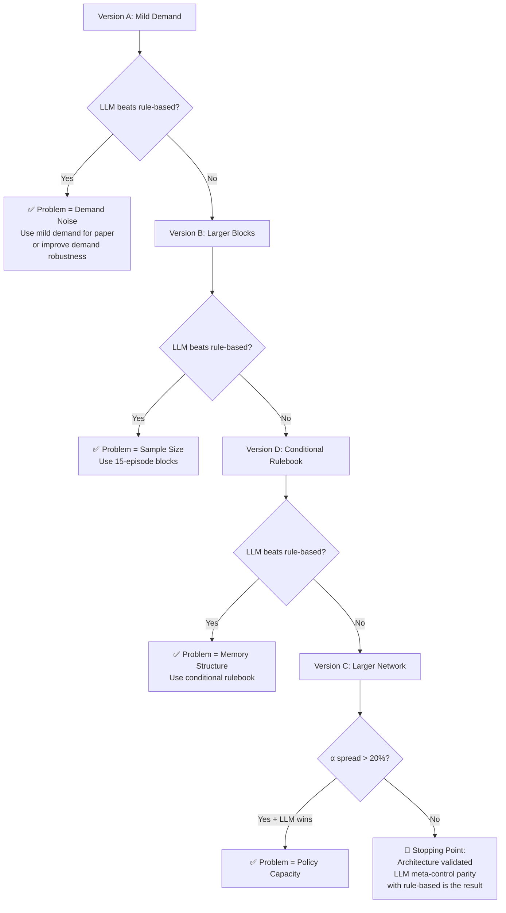

# Comparative Study Plan: Fixing LLM Meta-Controller Performance

## The Root Problem — Diagnosis

Your intuition is correct on both counts. Let me explain **why** things are breaking down:

### 1. The Rulebook Is Generic Because the Signal-to-Noise Ratio Is Terrible

Look at the 6 rules the LLM learned:

> "Adjust alpha values with a greater emphasis on agents exhibiting higher cost shares..."
> "Focus on reducing alphas for agents with elevated cost shares..."
> "Tailor alpha adjustments specifically to align agent behavior..."

These are all variations of **"lower alpha for expensive agents."** That's not a learned insight — that's literally what's already written in the system prompt. The LLM is regurgitating the prompt because the demand is so volatile that the LLM can't identify stable causal patterns during 10 warm-up blocks.

**Why?** Merton Jump Diffusion with `lambda=15` (15 Poisson jumps per episode) creates massive variance. Each 5-episode block sees completely different demand profiles. The LLM looks at Block 1 and sees "lowering Warehouse alpha helped," then Block 2 has a totally different demand spike pattern where the same strategy hurts. After 10 blocks of conflicting evidence, the only safe rule is the generic one.

### 2. The Policy Itself Has Low Alpha-Discrimination Resolution

From the grid search, the **entire cost range** across all α configurations is only **15,964 → 17,733** (a ~11% spread). The bullwhip ratio barely moves at all (3.01 → 3.07). This means:

- The frozen policy treats α as a weak signal relative to the demand noise
- Even a perfect oracle α-setter would only gain ~$1,770 vs the worst α choice
- With std ~5,000 per run, that $1,770 signal is **buried in noise**

The 128-hidden, 2-layer network with 8D observations may not have enough representational capacity to create sharply differentiated behaviors across the α spectrum while also handling the Merton demand complexity.

### 3. The Evaluation Window Is Too Short

5 episodes × 200 steps = 1,000 timesteps per evaluation block. With Merton spikes, a single outlier episode dominates the 5-episode average. The LLM is making decisions on statistically unreliable samples.

---

## What We Should NOT Do

> [!CAUTION]
> - Don't change everything at once — we'll never know what worked
> - Don't chase endless hyperparameter tweaks — diminishing returns
> - Don't retrain Phase 1 unless we first prove the meta-control layer can work with a *less noisy* environment

---

## Proposed Comparative Study: 4 Versions

Each version changes **exactly one thing** to isolate its effect. We run all 4 against the same 20 evaluation seeds and the same baselines.

---

### Version A: Tame the Demand (Environment Fix)

**What changes:** Reduce Merton volatility by reducing `lambda` from 15 → 5 and tightening the demand clamp.

**Why:** If the underlying signal-to-noise ratio is too low, no amount of LLM intelligence will help. This tests whether the architecture works when the problem is solvable.

#### [MODIFY] [generator.py](file:///c:/Users/PRO-LAB-4/Desktop/SCM_Episodic_META_LLM/MADRL/envs/generator.py)
- Create a `merton_mild` variant with `lambda=5`, `l3=0.005`

#### [MODIFY] [serial.py](file:///c:/Users/PRO-LAB-4/Desktop/SCM_Episodic_META_LLM/MADRL/envs/serial.py)
- Add a `DEMAND_REGIME` flag (`"mild"` / `"standard"`) to toggle between original and reduced volatility
- No change to policy or LLM code

**Expected outcome:** If this version dramatically improves LLM vs baselines, the core problem is demand noise, not architecture. If it doesn't help, the problem is deeper.

---

### Version B: Larger Evaluation Blocks (Statistical Fix)

**What changes:** Increase evaluation block size from 5 episodes to 15 episodes. The LLM gets more statistically reliable data per decision point.

**Why:** With 5 episodes and high variance demand, the LLM is essentially making decisions on noise. 15 episodes gives the law of large numbers a chance to work.

#### [MODIFY] Phase 2 runner
- Change `block_size` from 5 → 15
- Keep total evaluation episodes the same (so fewer LLM decision points)

**Expected outcome:** The LLM's individual decisions become more reliable, but it gets fewer chances to adapt. Tests whether the problem is *decision quality* vs *decision frequency*.

---

### Version C: Phase 1 Capacity Increase (Policy Fix)

**What changes:** Retrain Phase 1 with `hidden_size=256` and `layer_N=3` (currently 128/2). The actor gets more capacity to differentiate α-conditioned behaviors.

**Why:** The grid search showed only ~11% cost variation across the entire α spectrum. A larger network might create sharper α-conditional behavioral modes, giving the LLM a more responsive steering wheel.

#### [MODIFY] [config.py](file:///c:/Users/PRO-LAB-4/Desktop/SCM_Episodic_META_LLM/MADRL/config.py)
- `hidden_size`: 128 → 256
- `layer_N`: 2 → 3
- This roughly quadruples the parameter count (~944K → ~3.8M)

#### Retrain Phase 1
- Full training run with same convergence criteria
- New stability gate validation
- New alpha sensitivity audit to compare cost spread

> [!IMPORTANT]
> This is the most expensive version (full Phase 1 retrain). Only do this if Version A or B don't solve the problem, OR run it in parallel if compute time allows.

**Expected outcome:** If the alpha sensitivity audit shows a wider cost spread (say 20%+ instead of 11%), then the LLM has a more powerful lever. If the spread is still ~11%, capacity isn't the bottleneck.

---

### Version D: Structured LLM Memory (Prompt Fix)

**What changes:** Replace the generic rulebook with a structured conditional memory — the LLM stores rules keyed by demand regime, not generic rules.

**Why:** The current rulebook is flat: just a list of 6 generic sentences. The LLM can't distinguish "what works in high-volatility blocks" from "what works in calm blocks." A conditional rulebook lets it build context-specific strategies.

#### [MODIFY] [rulebook.py](file:///c:/Users/PRO-LAB-4/Desktop/SCM_Episodic_META_LLM/MADRL/llm/rulebook.py)
- Change rulebook structure from `List[str]` to `Dict[str, List[str]]` keyed by demand regime:
  ```json
  {
    "high_volatility": ["rule1", "rule2"],
    "normal": ["rule3"],
    "low_volatility": ["rule4"]
  }
  ```

#### [MODIFY] [prompt_builder.py](file:///c:/Users/PRO-LAB-4/Desktop/SCM_Episodic_META_LLM/MADRL/llm/prompt_builder.py)
- Classify current block's demand into a regime (based on skewness/kurtosis thresholds)
- Only inject relevant rules into the prompt, not the entire rulebook

**Expected outcome:** The LLM stops averaging contradictory experiences and starts applying context-appropriate strategies.

---

## Run Order and Decision Tree



## The Stopping Point

> [!IMPORTANT]
> **You stop when one of these is true:**
> 1. **Win:** The LLM statistically beats rule-based on cost OR service level (p < 0.05 on a paired t-test across 20+ seeds). → Paper reports the winning configuration.
> 2. **Parity with insight:** The LLM matches rule-based, but you can show its alpha trajectories are interpretable and it adapts to demand regime changes (qualitative contribution). → Paper frames it as "the LLM achieves competitive performance while providing interpretable strategic reasoning."
> 3. **Negative result after all 4 versions:** → Paper honestly reports that episodic LLM meta-control does not outperform simple heuristics in highly stochastic SCM environments, and analyzes why. This is still a valid contribution.

## Verification Plan

### For Each Version
1. Run 20-seed evaluation with identical seeds across all methods
2. Compute paired t-test: LLM vs Rule-Based on total cost
3. Log alpha trajectories for qualitative analysis
4. Record demand regime classification per block (for Version D)

### Comparison Table (Target Output)
| Version | LLM Cost | Rule Cost | p-value | LLM Wins? | α Spread |
|---------|----------|-----------|---------|-----------|----------|
| Current | 15,986   | 15,670    | —       | No        | 11%      |
| A       | ?        | ?         | ?       | ?         | —        |
| B       | ?        | ?         | ?       | ?         | —        |
| C       | ?        | ?         | ?       | ?         | ?%       |
| D       | ?        | ?         | ?       | ?         | —        |

### Estimated Time
- **Version A:** ~30 min (no retrain, just eval with modified demand)
- **Version B:** ~30 min (just change block size)
- **Version D:** ~1 hour (modify rulebook + prompt + re-run warmup + eval)
- **Version C:** ~4-6 hours (full Phase 1 retrain + stability gate + audit + Phase 2 eval)

**Total: ~6-8 hours if sequential. Versions A, B, D can run in parallel (~1.5 hours), then C if needed.**
